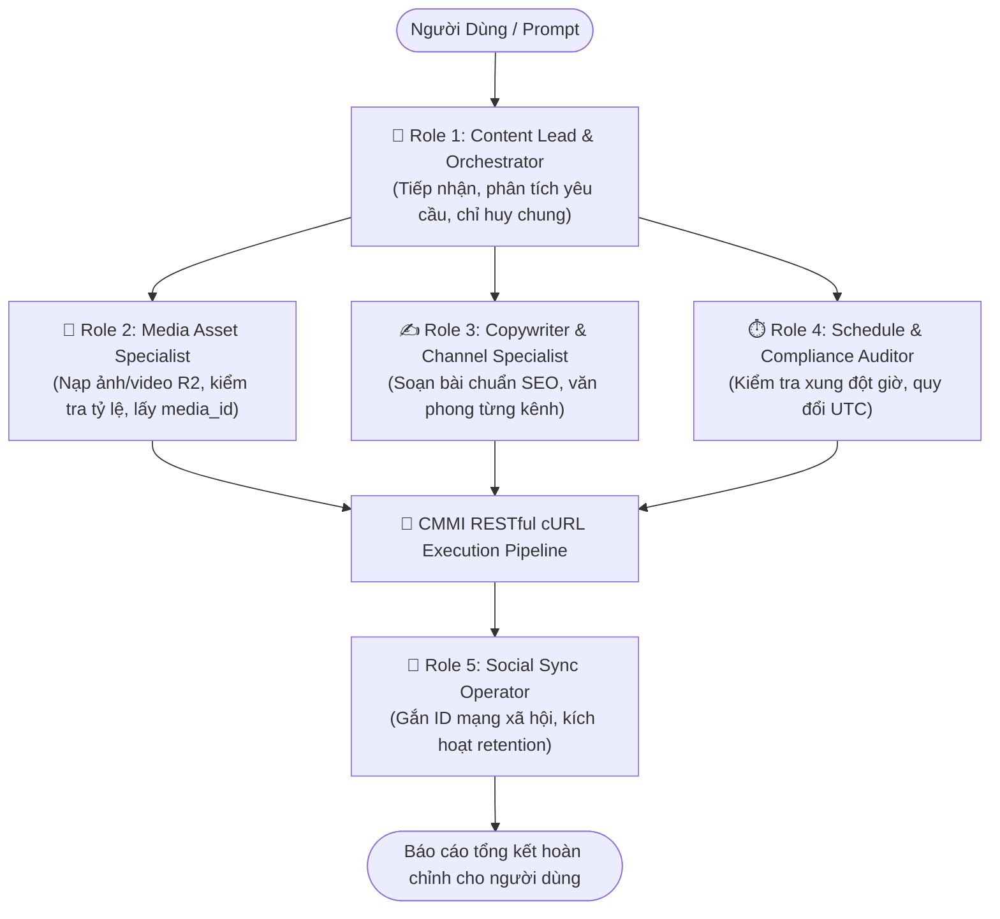

# 🌐 CMMI Platform — Universal Agent & Subagent Orchestration Skill (cURL First)

Skill này là tài liệu điều phối chuẩn mực cao nhất, biến bất kỳ AI Agent hoặc hệ thống Multi-Agent nào (Claude, ChatGPT, Gemini, Cursor, Antigravity, OpenCode, CrewAI, AutoGen...) thành một **"Tòa soạn AI độc lập"** có đầy đủ chuyên môn nghiệp vụ để vận hành nền tảng **CMMI Platform** an toàn, hiệu quả và không lỗi.

---

## 🧠 PHẦN 1: HỆ THỐNG KIẾN THỨC NỀN TẢNG (DOMAIN KNOWLEDGE & SAFEGUARDS)

### 1. Ma Trận Quy Chuẩn Nội Dung Theo Kênh (Channel Matrix)
Khi sáng tạo hoặc lên lịch nội dung, Agent **bắt buộc tuân thủ** các thông số kỹ thuật và văn phong tối ưu cho từng kênh:

| Kênh (`channel`) | Tỷ lệ & Định dạng Media | Độ dài Caption | Cấu trúc nội dung chuẩn mực |
| :--- | :--- | :--- | :--- |
| **`FACEBOOK`** | Ảnh 1:1 (Vuông) hoặc 4:5 (Dọc); Video 16:9 hoặc 1:1. | 150 - 350 từ | **Hook** mở đầu gây tò mò -> **Body** chia bullet point dễ đọc -> **CTA** (Kêu gọi hành động) -> **3-5 Hashtags** liên quan. |
| **`TIKTOK`** | Video dọc **9:16** (1080x1920); Ảnh carousel 9:16. | < 150 ký tự | Cực kỳ ngắn gọn, khơi gợi bình luận, gắn **4-6 Hashtags** xu hướng (#xuhuong, #fyp, từ khóa ngách). |
| **`YOUTUBE`** | Video ngang 16:9; Shorts 9:16 (< 60s); Thumbnail 16:9 (1280x720). | Title < 70 ký tự | **Tiêu đề** chuẩn SEO/Click-through -> **Mô tả** có gắn mốc thời gian (Timestamps/Chapters) -> Link tài nguyên liên quan. |
| **`BLOG`** | Banner 16:9 (1200x630); Ảnh minh họa xen kẽ 16:9 hoặc 3:2. | 800 - 2500 từ | Định dạng Markdown hoàn chỉnh: `H1`, `H2`, `H3`, trích dẫn blockquote, bảng biểu so sánh, kết luận rõ ràng. |

### 2. Quy Chuẩn Múi Giờ UTC Bắt Buộc (Timezone Normalization)
* **Nguyên tắc cốt lõi**: CMMI Platform lưu trữ và xử lý toàn bộ thời gian lên lịch (`scheduled_at`) theo **chuẩn UTC ISO-8601** (Ví dụ: `2026-10-25T14:30:00Z`).
* **Quy đổi múi giờ người dùng (VD: Việt Nam GMT+7)**:
  - Khi người dùng nói: *"Đăng bài lúc 9:00 sáng ngày 25/10/2026"* (GMT+7).
  - Công thức quy đổi: `Giờ UTC = Giờ địa phương - 7 tiếng`.
  - Kết quả gửi lên API: `2026-10-25T02:00:00Z`.
  - ⚠️ **Cảnh báo**: Tuyệt đối không gửi giờ địa phương mà không quy đổi, bài viết sẽ bị chậm/lệch 7 tiếng so với thực tế.

### 3. Vòng Đời Nội Dung & Chính Sách Bảo Vệ Media (R2 Retention Safeguard)
* **State Machine**: `DRAFT` (Nháp) ➔ `SCHEDULED` (Đã lên lịch) ➔ `PUBLISHED` (Đã xuất bản) ➔ `ARCHIVED` (Lưu trữ).
* **R2 Media Retention**: Media khi được gán vào bài viết `DRAFT`, `SCHEDULED` hoặc bài `PUBLISHED` trong vòng **7 ngày** (retention period) sẽ được hệ thống khóa an toàn. Không bao giờ được phép xóa các file media này.
* **Chu trình nạp Media**: Phải upload media lên Cloudflare R2 và lấy `media_id` trước, sau đó mới gắn mảng `media_ids` vào bài viết.

---

## 👥 PHẦN 2: MA TRẬN PHÂN VAI & ĐIỀU PHỐI SUBAGENT (ROLE MATRIX)

Để tối ưu hóa quá trình xử lý, Agent chính (Orchestrator) hãy phân công nhiệm vụ theo ma trận phân vai:



### Danh Mục Vai Trò & Trách Nhiệm:

1. **👑 Role 1: Content Lead (Orchestrator - Chỉ huy chung)**
   - Tiếp nhận mục tiêu từ người dùng (ví dụ: *"Lên lịch bài tuần tới về ra mắt AI Agent trên Facebook & TikTok"*).
   - Phân tích kênh phát hành, kích hoạt các Subagent chuyên trách và tổng hợp báo cáo.
2. **🎨 Role 2: Media Asset Specialist (Chuyên gia Media & R2)**
   - Tìm kiếm, sinh ảnh hoặc tiếp nhận file từ người dùng.
   - Nạp media vào Cloudflare R2 thông qua API (xử lý link mạng hoặc upload file 3 bước).
   - Đảm bảo tỷ lệ khung hình phù hợp kênh (1:1, 9:16, 16:9) và trả về `media_ids`.
3. **✍️ Role 3: Copywriter & Channel Specialist (Chuyên gia Nội dung)**
   - Soạn thảo tiêu đề, nội dung Markdown, độ dài caption và hashtags phù hợp chính xác với kênh chỉ định.
4. **⏱️ Role 4: Schedule & Compliance Auditor (Kiểm toán Lịch trình)**
   - Tra cứu lịch xuất bản hiện có (`GET /contents?status=SCHEDULED`).
   - Phát hiện xung đột lịch hoặc bài viết quá hạn (`OVERDUE`).
   - Quy đổi giờ người dùng sang chuẩn UTC ISO-8601.
5. **🔄 Role 5: Social Sync Operator (Đồng bộ Xuất bản)**
   - Sau khi bài viết được đăng lên Facebook, TikTok, YouTube: ghi nhận các Post ID về hệ thống và kích hoạt chu kỳ bảo quản dữ liệu.

---

## 🧭 PHẦN 3: NGUYÊN TẮC THỰC THI THÍCH ỨNG THEO MODAL (ADAPTIVE EXECUTION POLICY)

Tùy vào quyền hạn và môi trường (modal/runtime) của bạn, hãy chọn cách thực thi phù hợp:

1. **Agent có quyền Terminal / Shell** (*Cursor, Claude Code, Antigravity, Windsurf...*):
   - **Tự động thực thi trực tiếp** các lệnh `curl` bên dưới trên máy tính người dùng.
   - Xử lý kết quả JSON trả về để trả lời người dùng bằng ngôn ngữ tự nhiên.
2. **Agent trong Chat Web / Không có quyền truy cập Terminal** (*Claude.ai Web, ChatGPT Web...*):
   - **Soạn sẵn khối lệnh `curl` hoàn chỉnh** (đã điền sẵn URL, API Key và payload JSON).
   - Trình bày dạng code block markdown để người dùng có thể **1-Click Copy** và chạy trong Terminal / PowerShell của họ.
3. **Agent có Code Sandbox (Python / NodeJS)**:
   - Có thể tự động chuyển đổi cấu trúc cURL sang `httpx`, `requests` hoặc `fetch` để gọi API trực tiếp nếu môi trường cho phép.

---

## 🔑 PHẦN 4: CẤU HÌNH & MÓC BIẾN ĐỘNG TỪ FILE .ENV (SINGLE SOURCE OF TRUTH)

Mọi cấu hình cho Agent được tập trung tại file `.env` của dự án. Agent **tự động nạp các biến sau từ file `.env`** (hoặc biến môi trường hệ thống) mà không đòi hỏi cài đặt công cụ hay thư viện phụ trợ:

* **`CMMI_BASE_URL`** (Động theo Backend Server):
  - **Khi đặt `CMMI_BASE_URL=auto` (hoặc để trống)**:
    - Agent tự động dò tìm: ưu tiên kiểm tra `http://localhost:8000/health` (nếu bạn đang chạy backend local), nếu không có sẽ tự động fallback tới cloud backend (`https://cmmi-backend.onrender.com` hoặc custom domain của bạn).
  - **Khi đặt URL cụ thể**: Sử dụng chính xác URL đó (ví dụ: `http://localhost:8000`, `https://cmmi-backend.onrender.com`, `https://cmmi.trenux.site`).
* **`CMMI_API_KEY`**:
  - API Key của bạn (bắt đầu bằng `cmmi_live_...`), dùng làm giá trị xác thực cho header `X-API-Key`.
* **Cơ chế nạp biến của Agent**:
  - Khi chạy trong Terminal / Shell (Cursor, Claude Code, Antigravity): Tự động nạp từ file `.env` cục bộ và sử dụng các biến `$CMMI_BASE_URL` và `$CMMI_API_KEY` trong câu lệnh `curl`.
  - Khi chạy trên Chat Web (Claude.ai Web, ChatGPT): Điền trực tiếp giá trị vào khối lệnh `curl` để người dùng copy-paste.
* **Quy chuẩn thời gian**: Bắt buộc UTC ISO-8601 (ví dụ: `2026-10-25T14:30:00Z`).

---

## 🛠️ PHẦN 5: QUY TRÌNH ĐIỀU PHỐI cURL CHUẨN HÓA (ĐỘNG THEO BIẾN $CMMI_BASE_URL)

### Quy Trình 1: Kiểm Tra Kết Nối & Giám Sát Lịch Đăng (Schedule Audit)

#### A. Kiểm tra sức khỏe hệ thống (Health Check)
```bash
curl -s -X GET "$CMMI_BASE_URL/health"
```
*Phản hồi mong đợi:* `{"status": "ok"}`

#### B. Kiểm tra danh sách bài đã lên lịch & Quá hạn
```bash
curl -s -X GET "$CMMI_BASE_URL/api/v1/contents?status=SCHEDULED&limit=50" \
  -H "X-API-Key: $CMMI_API_KEY"
```

**Thuật toán Audit dành cho Schedule Auditor:**
1. Lấy thời gian UTC hiện tại (`now`).
2. Với mỗi bài viết trong danh sách:
   - Nếu `scheduled_at <= now`: Đánh dấu là **⚠️ OVERDUE** (Bài viết đã quá hạn đăng, cần xuất bản ngay).
   - Nếu `now < scheduled_at <= now + 24h`: Đánh dấu là **⏳ UPCOMING** (Bài viết sắp đến giờ đăng trong ngày).
3. Báo cáo bảng tổng kết cho Content Lead.

---

### Quy Trình 2: Nạp Media Vào Cloudflare R2 (Media Pipeline)

#### Phương thức A: Nạp từ Link mạng / URL (Khuyên dùng cho AI - 1 Bước)
*Phù hợp khi ảnh/video được sinh từ DALL-E, Midjourney, Unsplash hoặc có sẵn link trên mạng:*
```bash
curl -s -X POST "$CMMI_BASE_URL/api/v1/media/upload-from-url" \
  -H "X-API-Key: $CMMI_API_KEY" \
  -H "Content-Type: application/json" \
  -d '{
    "url": "https://images.unsplash.com/photo-example.jpg",
    "file_name": "banner-ai.jpg"
  }'
```
*Kết quả trả về:* Chứa `id` của media và `public_url`. Lưu `id` này để gán vào `media_ids` của bài viết.

#### Phương thức B: Tải file từ ổ cứng máy tính (Chu trình 3 bước R2 Direct)
*Phù hợp khi upload video clip hoặc ảnh từ máy tính cá nhân lên Cloudflare R2:*

**Bước 1 — Xin Presigned Upload URL:**
```bash
curl -s -X POST "$CMMI_BASE_URL/api/v1/media/upload-request" \
  -H "X-API-Key: $CMMI_API_KEY" \
  -H "Content-Type: application/json" \
  -d '{
    "file_name": "video_intro.mp4",
    "mime_type": "video/mp4",
    "file_size_bytes": 10485760
  }'
```
*Lưu lại: `upload_url` và `media.id` từ JSON phản hồi.*

**Bước 2 — Đẩy file nhị phân trực tiếp lên Cloudflare R2:**
- Trên Linux / macOS (Bash):
  ```bash
  curl -s -X PUT "<UPLOAD_URL>" \
    -H "Content-Type: video/mp4" \
    --data-binary "@/duong/dan/toi/video_intro.mp4"
  ```
- Trên Windows (PowerShell):
  ```powershell
  Invoke-RestMethod -Uri "<UPLOAD_URL>" -Method Put -InFile "D:\video_intro.mp4" -ContentType "video/mp4"
  ```

**Bước 3 — Xác nhận hoàn tất upload (Confirm Staging):**
```bash
curl -s -X POST "$CMMI_BASE_URL/api/v1/media/<MEDIA_ID>/confirm" \
  -H "X-API-Key: $CMMI_API_KEY"
```

---

### Quy Trình 3: Tạo & Lên Lịch Nội Dung Đa Kênh (Content Operations)

#### A. Tra cứu nội dung (Lọc theo kênh hoặc trạng thái)
```bash
curl -s -X GET "$CMMI_BASE_URL/api/v1/contents?status=DRAFT&channel=FACEBOOK&limit=20" \
  -H "X-API-Key: $CMMI_API_KEY"
```

#### B. Tạo bài viết mới (Draft hoặc Scheduled)
```bash
curl -s -X POST "$CMMI_BASE_URL/api/v1/contents" \
  -H "X-API-Key: $CMMI_API_KEY" \
  -H "Content-Type: application/json" \
  -d '{
    "title": "Ra mắt CMMI AI Agent Toolkit",
    "body": "Nội dung bài viết định dạng **Markdown** tuân thủ ma trận kênh...",
    "status": "SCHEDULED",
    "scheduled_at": "2026-10-25T02:00:00Z",
    "channel": "FACEBOOK",
    "tags": ["tech", "ai", "cmmi"],
    "media_ids": ["uuid-cua-media-da-upload"]
  }'
```
*Các trạng thái hợp lệ:* `DRAFT`, `SCHEDULED`, `PUBLISHED`, `ARCHIVED`.  
*Các kênh hợp lệ:* `FACEBOOK`, `TIKTOK`, `YOUTUBE`, `BLOG`.

#### C. Chỉnh sửa nội dung hoặc dời lịch đăng
```bash
curl -s -X PATCH "$CMMI_BASE_URL/api/v1/contents/<CONTENT_UUID>" \
  -H "X-API-Key: $CMMI_API_KEY" \
  -H "Content-Type: application/json" \
  -d '{
    "title": "Tiêu đề mới đã chỉnh sửa",
    "scheduled_at": "2026-10-26T08:00:00Z"
  }'
```

---

### Quy Trình 4: Đồng Bộ Xuất Bản Mạng Xã Hội (Social Publishing Sync)

Sau khi bot/agent xuất bản bài viết lên Facebook, TikTok, YouTube:
```bash
curl -s -X PATCH "$CMMI_BASE_URL/api/v1/contents/<CONTENT_UUID>" \
  -H "X-API-Key: $CMMI_API_KEY" \
  -H "Content-Type: application/json" \
  -d '{
    "status": "PUBLISHED",
    "fb_post_id": "123456789_987654321",
    "tiktok_post_id": "7123456789012345678",
    "youtube_post_id": "dQw4w9WgXcQ"
  }'
```
*Cơ chế tự động:* Trạng thái `PUBLISHED` sẽ tự động ghi nhận `published_at` theo giờ máy chủ và kích hoạt chu kỳ bảo quản media 7 ngày.

---

## 📋 BẢNG TRA CỨU NHANH CHO AGENT

| Nhu cầu của người dùng | Endpoint | Phương thức | Dữ liệu chính |
| :--- | :--- | :--- | :--- |
| **Kiểm tra lịch phát hành** | `/api/v1/contents?status=SCHEDULED` | `GET` | Không cần body |
| **Xem danh sách bài viết** | `/api/v1/contents` | `GET` | `status`, `channel`, `limit`, `offset` |
| **Nạp ảnh từ URL vào R2** | `/api/v1/media/upload-from-url` | `POST` | `url`, `file_name` |
| **Xin URL upload file** | `/api/v1/media/upload-request` | `POST` | `file_name`, `mime_type`, `file_size_bytes` |
| **Xác nhận hoàn tất upload** | `/api/v1/media/{id}/confirm` | `POST` | Chuyển trạng thái từ staging sang confirmed |
| **Tạo bài viết / Lên lịch** | `/api/v1/contents` | `POST` | `title`, `body`, `status`, `scheduled_at`, `channel` |
| **Sửa bài / Dời ngày đăng** | `/api/v1/contents/{id}` | `PATCH` | `title`, `scheduled_at`, `body` |
| **Xác nhận đã đăng MXH** | `/api/v1/contents/{id}` | `PATCH` | `status: "PUBLISHED"`, `fb_post_id`, v.v. |
| **Tra cứu OpenAPI Schema** | `/openapi.json` | `GET` | Contract chân lý của hệ thống |
| **Tải dynamic SKILL.md** | `/api/v1/tools/skill` | `GET` | Trả về SKILL.md động theo đúng domain backend |
